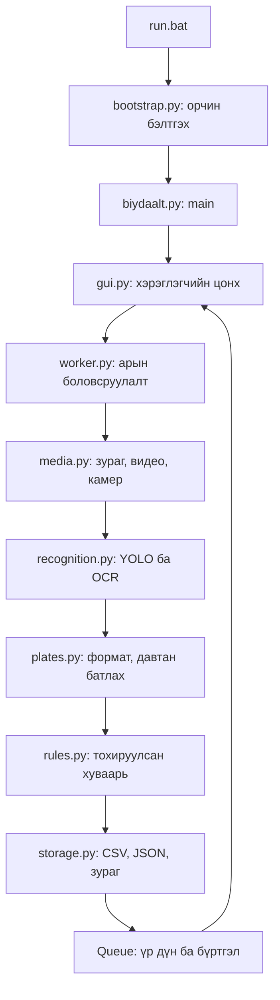

# PlateWatch: аль файлд ямар код ажилладаг вэ?

Энэ төсөл нь зураг, видео, камераас автомашины дугаар унших Python desktop програм. Цонхыг Tkinter, дүрс боловсруулахыг OpenCV/Pillow, дугаарын хүрээ олохыг YOLO, бичгийг уншихыг PP-OCRv5 болон EasyOCR хариуцна. Үндсэн дэмжих формат нь **4 цифр + 3 кирилл үсэг**.

## 1. Хавтасны зураглал

```text
төслийн хавтас/ 
├── run.bat                    Програм асаах
├── camera.bat                 Камерыг шууд эхлүүлэх
├── build_exe.bat              Windows EXE бүтээх
├── biydaalt.py                Python програмын эхлэх цэг
├── bootstrap.py               .venv, сангийн бэлэн байдлыг шалгах
├── requirements.txt           Python сангуудын шаардлага
├── README.md                  Эхэлж унших товч заавар
├── platewatch/                Програмын үндсэн код
├── tools/                     Шалгах, AI бэлтгэх, сургах, EXE бүтээх хэрэгслүүд
├── tests/                     Автомат тестүүд
├── configs/                   Өгөгдлийн тохиргооны загвар
├── docs/                      Код, хэрэглээ, хамгаалалт, шалгалтын тайлбар
├── models/                    Бэлэн эсвэл өөрийн сургасан YOLO жин
├── data/                      Хэрэглэгчийн бүртгэл, тохиргоо, OCR жингийн кэш
├── test_artifacts/            Шалгалтын тайлан, дэлгэцийн зураг, туршилтын бүртгэл
├── archive/                   Өмнөх түр файлууд, цэгцэлсэн замын жагсаалт
├── build/                     EXE бүтээх үеийн завсрын файлууд
└── dist/                      Бүтээсэн EXE багц
```

`.venv` нь сангууд суусан Python орчин, `.setup_tmp` нь суулгалтын түр хавтас, `__pycache__` нь Python-ийн өөрөө үүсгэдэг кэш. Эдгээр нь `.gitignore`-д орсон. `data` дахь бодит бүртгэл болон `test_artifacts` дахь туршилтын бүртгэл тусдаа.

## 2. Програм хаанаас эхэлдэг вэ?

1. Хэрэглэгч `run.bat` ажиллуулна.
2. `bootstrap.py` тохирох Python, төслийн `.venv`, шаардлагатай сангуудыг шалгана. Анхны удаа дутуу санг суулгана.
3. `.venv` доторх Python-оор `biydaalt.py`-ийн `main()` ажиллана.
4. `desktop_instance()` давхар цонх нээхийг зохицуулна. Дараа нь `PlateWatchApp()` цонх үүсэж, `mainloop()` хэрэглэгчийн үйлдлийг хүлээнэ.
5. Зураг/видео/камер сонгоход GUI ажлыг `DetectionWorker`-т өгнө. Таних хүнд ажлыг тусдаа thread гүйцэтгэж, үр дүнг queue-ээр GUI рүү буцаана.



Энэ нь өгөгдлийн ерөнхий урсгал. Бодит холбоосыг `worker.py`-ийн `_process()` дотроос харж болно.

## 3. Үндсэн Python файлуудын үүрэг

| Файл | Энд ямар код ажилладаг вэ? | Гол class / функц |
| --- | --- | --- |
| [biydaalt.py](../biydaalt.py) | Командын сонголт унших, цонх асаах, анхны зураг/видео/камерыг сонгох | `main()` |
| [bootstrap.py](../bootstrap.py) | `.venv` үүсгэх, шаардлагатай санг шалгах/суулгах, програмыг эхлүүлэх | `main()` |
| [gui.py](../platewatch/gui.py) | Цонх, товч, зураг, түүх, тохиргоо; хэрэглэгчийн үйлдлийг холбох | `PlateWatchApp`, `build_monitor()`, `start_source()`, `poll()` |
| [worker.py](../platewatch/worker.py) | Зураг/видео/камерын арын ажлыг удирдах; таних → шалгах → хадгалах дараалал | `DetectionWorker`, `run_images()`, `run_video()`, `run_camera()`, `_process()` |
| [media.py](../platewatch/media.py) | Файл унших, EXIF чиглэл засах, дүрс эргүүлэх, видео decoder болон камер нээх | `read_image()`, `open_video()`, `open_camera()`, `rotate_frame()` |
| [recognition.py](../platewatch/recognition.py) | YOLO ба OCR загвар ачаалах, дугаарын хүрээ олох, тайралтыг уншуулах, давхардсан хүрээ нэгтгэх | `PlateRecognizer`, `detect_image()`, `detect_video_frame()`, `read_crop()`, `annotate()` |
| [cyrillic_ocr.py](../platewatch/cyrillic_ocr.py) | Кирилл PP-OCRv5 загвараар бичиг унших, CTC гаралтыг текст болгох, уншилтуудыг харьцуулах | `CyrillicReader`, `read_line()`, `read_plate()`, `select_reading()` |
| [ocr.py](../platewatch/ocr.py) | Монгол/Англи EasyOCR үүсгэх, үсэг/тооны хэсгийг олох | `create_reader()`, `text_regions()` |
| [layout.py](../platewatch/layout.py) | Хазайсан хоёр мөртэй дугаарын бодит тоо, үсгийн мөрийг тусгаарлан тэгшлэх | `two_row_crops()`, `_row_pairs()` |
| [geometry.py](../platewatch/geometry.py) | YOLO хүрээ алгассан үед цайвар дөрвөлжин хавтангийн нэмэлт нэр дэвшигч олох | `plate_quadrilaterals()` |
| [plates.py](../platewatch/plates.py) | OCR тэмдэг цэвэрлэх, 4+3 формат шалгах, нэг машины уншилтыг давтан батлах, давхар хадгалалтыг хязгаарлах | `normalize_plate()`, `Detection`, `PlateTracker`, `TemporalGate` |
| [rules.py](../platewatch/rules.py) | Сүүлийн цифр, өдөр, цаг, хэрэглэгчийн тохируулсан хуваариар төлөв тооцох | `evaluate()`, `restriction_days()`, `RuleResult` |
| [storage.py](../platewatch/storage.py) | Бүртгэл, бүтэн кадр, тайралт, JSON хадгалах; түүх хайх, CSV экспортлох | `RecordStore`, `add()`, `query()`, `export()` |
| [settings.py](../platewatch/settings.py) | Анхдагч утга, хавтасны зам, Улаанбаатарын цаг, тохиргоо шалгах/хадгалах | `DEFAULTS`, `load_settings()`, `validated_settings()`, `atomic_json()` |
| [instance.py](../platewatch/instance.py) | Програмын давхар эхлэлтийг зохицуулах | `desktop_instance()` |
| [diagnostics.py](../platewatch/diagnostics.py) | GUI нээхгүйгээр бодит AI-аар нэг зургийг шалгаж JSON тайлан гаргах | `verify_image()` |
| [__init__.py](../platewatch/__init__.py) | Програмын хувилбар | `__version__` |

## 4. Зураг импортлоход яг юу болдог вэ?

| Дараалал | Хаана ажиллах вэ? | Үр дүн |
| --- | --- | --- |
| 1. Зураг сонгох | `gui.py → choose_images()` | Файлын замууд авна. |
| 2. Арын ажил эхлүүлэх | `start_source() → worker.start()` | GUI-ийн цонх ажилласаар байна. |
| 3. Эх пиксел унших | `worker.run_images() → media.read_image()` | EXIF чиглэлтэй BGR дүрс бэлэн болно. |
| 4. Дугаарын хүрээ олох | `PlateRecognizer.detect_image()` | YOLO дугаарын байршлыг гаргана; шаардлагатай үед том оролт, хэсэгчилсэн/геометр хайлт ашиглана. |
| 5. Бичиг унших | `read_crop() → CyrillicReader / EasyOCR` | Тайрсан хэсгээс тоо, үсэг уншина. Хоёр мөр хазайсан бол `layout.py` тусална. |
| 6. Формат шалгах | `plates.normalize_plate()` | Бүрэн 4 цифр + 3 үсэгтэй дугаар эсвэл хоосон үр дүн буцаана. |
| 7. Хуваарь тооцох | `rules.evaluate()` | Тохируулсан өдөр/цагийн төлөв гарна. |
| 8. Хадгалах | `RecordStore.add()` | Бүтэн зураг, дугаарын тайралт, JSON, CSV мөр үүснэ. |
| 9. Дэлгэц шинэчлэх | `worker.events → gui.poll()` | Дугаар, итгэлцүүр, түүх, тоолуур шинэчлэгдэнэ. |

Жишээ: `7960УЕХ` уншигдвал дэлгэцэд `7960 УЕХ` гэж зайтай харуулна. Хуваарь тооцохдоо **0** буюу дөрвөн тооны сүүлийн цифрийг авна. Хадгалсан JSON-д эх файл, хүрээний `bbox`, OCR-ийн эх текст, оноо, хуваарийн үр дүн орно.

## 5. Видео болон камерын ялгаа

**Видео:** `run_video()` бичлэгийн эхнээс тохируулсан кадрын зайгаар шалгана. Ердийн тоглуулалт ба AI шалгалт тусдаа decoder ашиглаж болно. “Видеог шалгах” үед шалгасан кадраар дүрс шинэчлэгдэнэ. `PlateTracker.confirm()` нэг машины ижил дугаарыг өөр бодит кадруудаас харьцуулна. `TemporalGate` нэг дугаарыг богино хугацаанд дахин дахин бүртгэхийг хязгаарлана. Хөрш кадрын баталгаа нэмэлт кадр шалгаж болох тул нийт шалгасан кадр нь энгийн хуваалтаас их байж болно.

**Камер:** `capture_camera()` төхөөрөмжөөс дүрс авч дэлгэцэд өгнө. `run_camera()` боломжтой хамгийн сүүлийн кадрыг AI-аар шалгана. Ингэснээр AI удаан байсан ч хуучин кадрууд урт дараалал үүсгэхгүй. Камер хаахад `release()` төхөөрөмжийг суллана.

**Энэ кадрыг таних:** `check_current_frame() → worker.check_frame()` дэлгэцэд харагдсан эх пиксел, эх файл, хугацааг ашиглана. Видеонд зөвшөөрсөн тооны ойролцоох бодит кадраар нэмэлт баталгаа хайж болно. Видео зогсоох нь харагдах дүрсийг царцаах бөгөөд арын видео шалгалт үргэлжилж болно; **■** товч ажлыг цуцална.

## 6. Өгөгдөл хаана хадгалагддаг вэ?

```text
data/
├── settings.json                  Хэрэглэгчийн тохиргоо
├── detections.csv                 Танигдсан дугаарын бүртгэл
├── app.log                        Ажиллагаа, алдааны мэдээлэл
├── evidence/YYYY-MM-DD/
│   ├── ..._7960УЕХ.jpg            Хүрээ зурсан бүтэн кадр
│   ├── ..._7960УЕХ_plate.jpg      Дугаарын хэсэг
│   └── ..._7960УЕХ.json           Байрлал, эх текст, оноо, хуваарийн мэдээлэл
├── models/ocr/                    OCR загваруудын кэш
├── snapshots/                     Гараар хадгалсан кадр
└── videos/                        Тохиргоогоор хадгалсан видео
```

CSV нь түүхийн хүснэгтэд ашиглагдана; JSON нь нэг илрэлтийн дэлгэрэнгүй мэдээлэлтэй. SQL сервер шаардлагагүй. `PLATEWATCH_DATA_DIR` тохируулбал хадгалалтын үндсэн хавтас өөрчлөгдөнө.

Зураг/видео импортын бүртгэлийн цаг нь **боловсруулсан цаг**; `video_seconds` нь бичлэгийн доторх байрлал. Камерын бүртгэлд авсан кадрын цаг ашиглагдана. Бүгд Улаанбаатарын UTC+08:00 цагийн суурьтай.

## 7. Хаана өөрчлөлт хийх вэ?

| Өөрчлөх зүйл | Эхэлж харах код |
| --- | --- |
| Товч, байрлал, өнгө, цонх | `gui.py → build_monitor()`, `build_settings()`, `configure_styles()` |
| Импортын үйлдэл, ажил эхлүүлэх/зогсоох | `gui.py → start_source()`, `worker.py → start() / stop()` |
| Камер олдохгүй, видео нээгдэхгүй | `media.py → open_camera() / open_video()`, дараа нь `data/app.log` |
| Дугаарын хүрээ буруу | `recognition.py → _detect_region()`, `geometry.py` |
| Хүрээ олдсон ч бичиг уншихгүй | `read_crop()`, `cyrillic_ocr.py`, `ocr.py`, хоёр мөртэй бол `layout.py` |
| Танигдсан тэмдэг/формат буруу | `plates.py → clean_text() / normalize_plate()` |
| Нэг машины дугаар олон давтагдах | `PlateTracker`, `TemporalGate`, тохиргооны батлах кадр/хүлээлт |
| Хязгаарлах өдөр, цаг | `rules.py`, GUI дахь Тохиргоо |
| Түүх, CSV экспорт | `storage.py`, `gui.py → refresh_records() / export_records()` |
| Анхдагч тохиргоо | `settings.py → DEFAULTS` |
| AI загварыг өөр өгөгдлөөр сургах | `tools/train.py`, `configs/dataset.example.yaml` |

## 8. Тест болон туслах хэрэгслүүд

`tests/` дахь автомат тестүүд кодын ажиллагаа, алдааны нөхцөл, дүрс/өгөгдлийн урсгалыг шалгана. Одоогийн **109 тест** нь 109 бодит автомашины зураг гэсэн үг биш. Бодит загвартай зургийн шалгалтууд тусдаа `test_artifacts/` тайлантай.

| Тест | Гол шалгах зүйл |
| --- | --- |
| `test_core.py` | Дугаарын формат, хуваарь, хадгалалт, давтан батлах |
| `test_ocr.py`, `test_cyrillic_ocr.py` | OCR сонголт, зөрүүтэй уншилт, CTC, бүрэн мөрийн баталгаа |
| `test_layout.py`, `test_geometry.py` | Хазайсан мөр, дутуу тэмдэг, геометрийн хайлт |
| `test_worker.py`, `test_media.py` | Арын ажил, зураг/видео/камер, цуцлах, алдаанаас сэргэх |
| `test_gui.py`, `test_instance.py` | Цонхны үйлдэл, эх үүсвэр солих, давхар эхлэлт |
| `test_recovery.py` | Гэмтсэн тохиргоо/CSV, тасарсан хадгалалт, файлын зам |

Төслийн үндсэн хавтаснаас ажиллуулна:

```powershell
.\.venv\Scripts\python.exe -m unittest discover -s tests -v
.\run.bat --smoke-test
.\.venv\Scripts\python.exe -m tools.verify_project --manifest test_artifacts/audit_2_8_1/cases.json --output test_artifacts/recheck
```

Туслах командуудын жагсаалт: [tools/README.md](../tools/README.md). Сүүлчийн бодит шалгалт: [VALIDATION.md](VALIDATION.md). Хамгаалалтад ярих бэлэн тайлбар: [PRESENTATION_MN.md](PRESENTATION_MN.md).

## 9. Загварын гарал ба хязгаар

YOLO болон OCR нь урьдчилан сургасан загварууд. Энэ төсөл тэдгээрийг холбож, Монгол дугаарын формат, хоёр мөртэй байрлал, баталгаажуулалт, хадгалалт, хэрэглэгчийн цонхыг хэрэгжүүлсэн. Монголын том тэмдэглэгээтэй өгөгдөл дээр өөрийн сургалт хийсэн гэж тайлагнахгүй. Бодит эх үүсвэр, жингийн шалгалтыг `recognition.py`, `cyrillic_ocr.py`, [models/README.md](../models/README.md)-ээс харна.

OCR/YOLO хувийн оноо нь загварын итгэлцүүр; туршилтаар хэмжсэн зөв таних хувь биш. Бүдэг, халхлагдсан, маш жижиг дугаар болон өөр формат бүрэн уншигдахгүй байж болно. Хязгаарлалтын төлөв нь хэрэглэгчийн тохируулсан хуваарийн тооцоо. Програм нь шинэ зохицуулалтыг автоматаар татаж, торгууль шийдвэрлэдэг систем биш.
